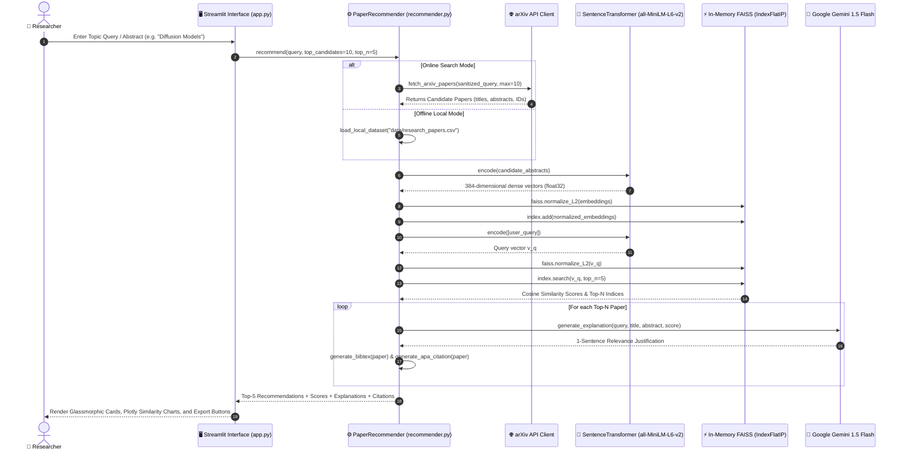

# 🔬 PaperMind AI: Intelligent Research Paper Recommendation & Scientific Document Intelligence System

[](https://www.python.org/)
[](https://streamlit.io/)
[](https://aistudio.google.com/)
[](https://github.com/facebookresearch/faiss)
[](https://huggingface.co/sentence-transformers/all-MiniLM-L6-v2)
[](https://www.langchain.com/)
[](https://opensource.org/licenses/MIT)

> **PaperMind AI** is an end-to-end research intelligence platform that bridges the gap between lexical literature search and grounded document comprehension. By integrating **dense vector semantic embeddings**, **hardware-accelerated FAISS inner-product matching**, **Google Gemini LLM reasoning**, and **page-attributed PyMuPDF RAG (Retrieval-Augmented Generation)**, PaperMind AI eliminates academic reading fatigue and lexical mismatch.

---

## 📑 Table of Contents

1. [🌟 Key Highlights & Innovations](#-key-highlights--innovations)
2. [🏛️ System Architecture](#-system-architecture)
3. [⚙️ Mathematical & Algorithmic Formulation](#-mathematical--algorithmic-formulation)
4. [🚀 Core Modules & Features](#-core-modules--features)
   - [1. Semantic Paper Recommender](#1-semantic-paper-recommender)
   - [2. Executive Deep Paper Critic](#2-executive-deep-paper-critic)
   - [3. Interactive RAG Paper Chatbot](#3-interactive-rag-paper-chatbot)
   - [4. Side-by-Side Paper Comparator](#4-side-by-side-paper-comparator)
   - [5. Dataset Explorer & Interactive Visualizations](#5-dataset-explorer--interactive-visualizations)
5. [📁 Project Directory Structure](#-project-directory-structure)
6. [🛠️ Tech Stack & Dependencies](#-tech-stack--dependencies)
7. [⚡ Getting Started (Installation & Setup)](#-getting-started-installation--setup)
   - [Prerequisites](#prerequisites)
   - [1. Clone / Navigate Repository](#1-clone--navigate-repository)
   - [2. Set Up Virtual Environment](#2-set-up-virtual-environment)
   - [3. Install Dependencies](#3-install-dependencies)
   - [4. Configure Environment Variables](#4-configure-environment-variables)
   - [5. Launch the Application](#5-launch-the-application)
8. [📊 Presentation & Academic Assets](#-presentation--academic-assets)
9. [❓ Troubleshooting & FAQ](#-troubleshooting--faq)
10. [🔮 Future Roadmap](#-future-roadmap)
11. [📄 License & Acknowledgments](#-license--acknowledgments)

---

## 🌟 Key Highlights & Innovations

- **Zero-Keyword-Drift Semantic Retrieval**: Employs fine-tuned Siamese neural embeddings (`all-MiniLM-L6-v2`) to capture abstract concepts, cross-domain synonyms, and semantic nuances instead of crude BM25/TF-IDF keyword matching.
- **Sub-15ms Similarity Search**: $L_2$-normalized inner product indexing with FAISS (`IndexFlatIP`) achieves lightning-fast, zero-distortion cosine similarity retrieval across large candidate sets on standard CPU hardware.
- **Multi-Source Discovery**: Search directly against live **arXiv API** (millions of preprints), a curated local baseline dataset (`data/research_papers.csv`), or upload custom CSV bibliographies.
- **Explainable Recommendation Synthesis**: Unlike black-box recommendation engines, Google Gemini synthesizes concise, single-sentence justifications explaining *why* each paper aligns with the researcher's query.
- **5-Pillar Executive Paper Critique**: Generates comprehensive structured academic critiques evaluating:
  1. *Core Methodology & Theoretical Framework*
  2. *Key Contributions & Innovations*
  3. *Critical Limitations & Assumptions*
  4. *Potential Applications & Future Directions*
  5. *Objective Rigor & Strengths Score*
- **Conversational RAG with Grounded Page Citations**: Ingests multi-page PDFs using high-speed **PyMuPDF**, chunks text via recursive character boundaries, builds ephemeral vector stores, and answers user queries with verifiable page-level references.
- **Side-by-Side Multi-Paper Comparator**: Automatically contrasts 2–3 papers simultaneously across objectives, methodologies, benchmarks, and tradeoffs in a unified markdown matrix.
- **Standardized Citation Exporters**: One-click generation of validated **BibTeX** and **APA 7th Edition** citations.
- **Modern Glassmorphic UI**: Clean, luminous white-canvas user interface built with Streamlit, Outfit/Inter typography, and interactive Plotly analytics.

---

## 🏛️ System Architecture

PaperMind AI is structured into four decoupled, modular layers:

```
+----------------------------------------------------------------------------------------------------+
|                                    1. UI & PRESENTATION LAYER                                      |
|  Streamlit Framework • Glassmorphic Light CSS • Plotly Visualizations • Dynamic Search Sliders     |
+----------------------------------------------------------------------------------------------------+
                                                  │
                                                  ▼
+----------------------------------------------------------------------------------------------------+
|                               2. APPLICATION & ORCHESTRATION LAYER                                 |
|  recommender.py (PaperRecommender)  │ paper_analyzer.py (PaperAnalyzer)  │ tools.py (RAG & Fitz)   |
|  • Candidate retrieval & scoring    │ • 5-Pillar Academic Critique       │ • PyMuPDF text parser   |
|  • In-memory FAISS orchestration    │ • Side-by-side comparator matrix   │ • RecursiveTextSplitter |
|  • BibTeX & APA citation formatter  │ • Multi-turn RAG chain QA          │ • Ephemeral vectorstore |
+----------------------------------------------------------------------------------------------------+
                                                  │
                                                  ▼
+----------------------------------------------------------------------------------------------------+
|                                3. AI, EMBEDDINGS & INFERENCE LAYER                                 |
|  • Embeddings: sentence-transformers / all-MiniLM-L6-v2 (384-dimensional dense vectors)           |
|  • Vector Search: FAISS-CPU (IndexFlatIP with L2 Normalization)                                    |
|  • Foundation LLM: Google Gemini (gemini-1.5-flash / gemini-2.0-flash via LangChain)                |
+----------------------------------------------------------------------------------------------------+
                                                  │
                                                  ▼
+----------------------------------------------------------------------------------------------------+
|                               4. INGESTION, STORAGE & DATA LAYER                                   |
|  • External Preprints: arXiv API Client (Live Metadata, Abstracts & PDF URLs)                     |
|  • Local Corpus: data/research_papers.csv (Curated offline papers across ML domains)              |
|  • PDF Document Engine: PyMuPDF (fitz) streaming & memory byte extraction                          |
|  • State Cache: Streamlit Session State & @st.cache_resource                                       |
+----------------------------------------------------------------------------------------------------+
```

### End-to-End Workflow



---

## ⚙️ Mathematical & Algorithmic Formulation

### 1. Vector Space Embedding
Abstracts and queries are projected into a continuous 384-dimensional latent semantic manifold:

$$\mathbf{v} = f_{\theta}(\text{text}) \in \mathbb{R}^{384}$$

Where $f_\theta$ is the `all-MiniLM-L6-v2` transformer encoder fine-tuned on 1B+ sentence similarity pairs.

### 2. Cosine Similarity via Inner Product Normalization
In Euclidean space, cosine similarity between a query vector $\mathbf{q}$ and paper representation $\mathbf{d}$ is defined as:

$$\text{Sim}(\mathbf{q}, \mathbf{d}) = \frac{\mathbf{q} \cdot \mathbf{d}}{\|\mathbf{q}\|_2 \|\mathbf{d}\|_2}$$

By applying $L_2$-normalization directly using FAISS before index population and search:

$$\hat{\mathbf{q}} = \frac{\mathbf{q}}{\|\mathbf{q}\|_2}, \quad \hat{\mathbf{d}} = \frac{\mathbf{d}}{\|\mathbf{d}\|_2}$$

The similarity computation reduces to a dot product:

$$\text{Sim}(\mathbf{q}, \mathbf{d}) = \hat{\mathbf{q}} \cdot \hat{\mathbf{d}} = \sum_{k=1}^{384} \hat{q}_k \hat{d}_k$$

This allows FAISS `IndexFlatIP` to perform exact cosine similarity computations with zero Euclidean distortion at hardware-accelerated speeds ($< 15\text{ ms}$).

---

## 🚀 Core Modules & Features

### 1. Semantic Paper Recommender
- **Input**: Natural language topic query, research hypothesis, or a pasted reference abstract.
- **Data Modes**:
  1. *Curated Offline Dataset*: 50+ seminal papers across Transformers, Vision, RL, and Generative AI.
  2. *Live arXiv Search*: Fetches candidate preprints dynamically via the `arxiv` client.
  3. *Upload Custom CSV*: Index and search arbitrary private bibliographic datasets.
- **Outputs**:
  - Semantic Match Percentage (e.g., `94.8% Match`).
  - LLM-generated rationale explaining relevance to the query.
  - Direct links to PDF and arXiv entry.
  - Interactive BibTeX & APA citation generators with one-click copy.

### 2. Executive Deep Paper Critic
- **Input**: Uploaded multi-page research paper PDF or pasted text.
- **Processing**: High-speed PyMuPDF byte extraction, metadata parsing, and token safety boundary capping.
- **Outputs**:
  - Complete 5-pillar academic review rendered in card format.
  - One-click `.md` critique report download button.

### 3. Interactive RAG Paper Chatbot
- **Input**: Research paper PDF.
- **Pipeline**: Ingests document $\rightarrow$ Chunks into 1,000-character segments with 200-character overlap $\rightarrow$ Constructs in-memory vector store $\rightarrow$ LangChain conversational QA.
- **Outputs**:
  - Grounded answers strictly anchored in the paper.
  - Expandable **"View Cited Excerpts"** accordions showing exact page numbers and snippet citations.
  - One-click prompt suggestion chips (*Core methodology*, *Evaluation metrics*, *Key limitations*).

### 4. Side-by-Side Paper Comparator
- **Input**: Select 2 or 3 research papers from the curated dataset or recent search history.
- **Outputs**: Comprehensive comparative matrix synthesizing:
  - Problem statement & core hypothesis.
  - Methodology & architectural differences.
  - Benchmark datasets & reported empirical metrics.
  - Trade-offs, compute requirements, and real-world deployment viability.

### 5. Dataset Explorer & Interactive Visualizations
- Real-time KPI metrics (Total Indexed Papers, Research Domains, Timeline, Total Citations).
- Interactive **Plotly donut charts** (domain category distribution).
- Interactive **Plotly scatter plots** (Citation impact vs. Publication year).
- Searchable & filterable tabular dataset view with BibTeX downloaders.

---

## 📁 Project Directory Structure

```text
Research paper recommendation system/
│
├── .streamlit/
│   └── config.toml                  # Streamlit UI theme, font & server configuration
│
├── data/
│   └── research_papers.csv          # Curated offline dataset of foundational AI papers
│
├── app.py                           # Main Streamlit web application & tab coordinator
├── recommender.py                   # PaperRecommender: arXiv fetch, MiniLM embeddings, FAISS search
├── paper_analyzer.py                # PaperAnalyzer: PyMuPDF parser, 5-pillar critique & comparator
├── tools.py                         # Text extraction, chunking, RAG vectorstores, BibTeX/APA formatters
│
├── requirements.txt                 # Pinned project Python dependencies
├── .env.example                     # Environment template for Google Gemini API key
├── .env                             # Local secrets configuration (ignored in version control)
│
├── run.bat                          # 1-Click Windows Batch startup script (auto-kills stuck port 8501)
├── run.ps1                          # 1-Click PowerShell startup script with diagnostic checks
│
├── poster.html                      # Interactive, presentation-ready A1 academic poster (Print to PDF)
├── block_diagram.svg                # 4-Layer system architecture block diagram (High-res SVG)
├── workflow_diagram.svg             # End-to-end algorithmic pipeline sequence diagram (High-res SVG)
├── Arcitecture block digram.png      # Rendered architecture raster graphic
│
├── LITERATURE_REVIEW.md             # In-depth 8-paper technical literature review report
├── POSTER_AND_DIAGRAMS_GUIDE.md     # Presentation guide, poster instructions & Mermaid source code
└── README.md                        # Master project documentation
```

---

## 🛠️ Tech Stack & Dependencies

| Layer | Component | Version / Model | Role in Architecture |
| :--- | :--- | :--- | :--- |
| **Frontend** | [Streamlit](https://streamlit.io/) | `>=1.30.0` | Reactive web interface, session state & tabs |
| **Styling** | Vanilla CSS3 + Google Fonts | `Outfit`, `Inter` | Luminous glassmorphic theme & responsive layout |
| **Visualizations** | [Plotly](https://plotly.com/python/) | `>=5.18.0` | Interactive category distributions & scatter plots |
| **Embeddings** | [Sentence-Transformers](https://www.sbert.net/) | `all-MiniLM-L6-v2` | 384-dimensional dense semantic vectors |
| **Vector Engine** | [FAISS CPU](https://github.com/facebookresearch/faiss) | `>=1.7.4` | In-memory exact inner product index (`IndexFlatIP`) |
| **Foundation LLM**| [Google Gemini](https://ai.google.dev/) | `gemini-1.5-flash` | Relevance reasoning, 5-pillar critique & RAG |
| **RAG Orchestration**| [LangChain](https://www.langchain.com/) | `>=0.2.0` | Prompt templates, document chunking & QA chains |
| **PDF Extraction** | [PyMuPDF (fitz)](https://pymupdf.readthedocs.io/) | `>=1.23.0` | High-speed multi-page PDF text & metadata extraction |
| **Academic Source**| [arXiv API](https://pypi.org/project/arxiv/) | `>=2.1.0` | Querying live preprint archives |
| **Data Storage** | [Pandas](https://pandas.pydata.org/) | `>=2.0.0` | Tabular dataset manipulation and parsing |

---

## ⚡ Getting Started (Installation & Setup)

### Prerequisites
- **Python**: Version `3.10` or higher recommended.
- **Operating System**: Windows, macOS, or Linux.
- **API Key**: A free **Google Gemini API Key** from [Google AI Studio](https://aistudio.google.com/).

---

### 1. Clone / Navigate Repository

Open your terminal or command prompt and navigate to the project directory:

```bash
cd "Research paper recommendation system"
```

---

### 2. Set Up Virtual Environment

It is strongly recommended to use a virtual environment or conda:

**Using Python venv:**
```bash
# Windows
python -m venv venv
venv\Scripts\activate

# macOS / Linux
python3 -m venv venv
source venv/bin/activate
```

**Using Conda (Alternative):**
```bash
conda create -n papermind python=3.10 -y
conda activate papermind
```

---

### 3. Install Dependencies

Install the pinned packages using `pip`:

```bash
pip install -r requirements.txt
```

> **Note on PyTorch / Sentence-Transformers**: If your environment requires PyTorch for `sentence-transformers`, pip will automatically install the CPU-compatible wheel.

---

### 4. Configure Environment Variables

1. Copy the sample environment file:
   ```bash
   # Windows (Command Prompt)
   copy .env.example .env

   # Windows (PowerShell) or Linux/macOS
   cp .env.example .env
   ```

2. Open `.env` and insert your Gemini API Key:
   ```env
   # Google Gemini API Key - Get yours from Google AI Studio (https://aistudio.google.com/)
   GOOGLE_API_KEY=AIzaSyYourActualGeminiApiKeyHere

   # Optional: Default Model Selection (e.g. gemini-1.5-flash, gemini-2.0-flash, gemini-1.5-pro)
   DEFAULT_MODEL=gemini-1.5-flash
   ```

*(Alternatively, you can leave the `.env` blank and enter your API key directly inside the app's sidebar during runtime!)*

---

### 5. Launch the Application

#### Option A: Quick-Launch Scripts (Windows)
Double-click `run.bat` or run:
```cmd
run.bat
```
*This script automatically frees port `8501` if an older instance was running and opens your default browser directly.*

#### Option B: Standard Streamlit CLI
Run the following command from the project root:
```bash
streamlit run app.py
```

The application will launch and open automatically at:
```text
http://localhost:8501
```

---

## 📊 Presentation & Academic Assets

For college project submissions, viva presentations, posters, and technical documentation, the project comes pre-bundled with presentation-ready assets:

| File | Description | Usage |
| :--- | :--- | :--- |
| [**`poster.html`**](file:///poster.html) | **Interactive Academic Poster** | Open in browser, press **Ctrl + P** (or click the print button) to export an **A1-sized Academic Conference Poster** in PDF. |
| [**`block_diagram.svg`**](file:///block_diagram.svg) | **System Architecture Block Diagram** | Scalable vector graphic diagram for research papers, LaTeX docs, or slides. |
| [**`workflow_diagram.svg`**](file:///workflow_diagram.svg) | **Algorithmic Workflow Diagram** | End-to-end sequence diagram from query to FAISS and Gemini generation. |
| [**`LITERATURE_REVIEW.md`**](file:///LITERATURE_REVIEW.md) | **8-Paper Literature Review** | Complete academic literature review surveying SBERT, MiniLM, FAISS, SPECTER, DPR, and RAG. |
| [**`POSTER_AND_DIAGRAMS_GUIDE.md`**](file:///POSTER_AND_DIAGRAMS_GUIDE.md) | **Poster & Diagram Guide** | Complete guide containing Mermaid diagrams, mathematical models, and presentation tips. |

---

## ❓ Troubleshooting & FAQ

### Q1: Can I use the system without a Gemini API Key?
**Yes!** The semantic vector search (Candidate retrieval, MiniLM encoding, and FAISS cosine similarity scoring) operates **100% offline on your local CPU**. The Gemini API Key is only needed for LLM-powered features: relevance reasoning explanations, deep paper critiques, and RAG chat.

### Q2: "Port 8501 is already in use" error on Windows?
Run `run.bat`, which includes an automatic port-killing command:
```cmd
for /f "tokens=5" %a in ('netstat -aon ^| findstr :8501 ^| findstr LISTENING') do taskkill /f /pid %a
```

### Q3: How do I handle scanned or image-only PDFs in the Chat/Critic?
The built-in parser in `paper_analyzer.py` checks character yield per page. If a PDF contains fewer than 50 characters, it flags a warning advising the user that the document appears scanned (image-only) and lacks an embedded digital text layer.

### Q4: Which Gemini model is used?
By default, the system utilizes `gemini-1.5-flash` for high-throughput, low-latency reasoning. You can specify `gemini-2.0-flash` or `gemini-1.5-pro` in `.env` or in the analyzer initializers.

---

## 🔮 Future Roadmap

- [ ] **Hybrid Retrieval (Dense + Sparse)**: Combine `all-MiniLM-L6-v2` dense vectors with BM25 keyword rankings via Reciprocal Rank Fusion (RRF).
- [ ] **Citation Network Graphs**: Visualizing citation graph connections using NetworkX and PyVis.
- [ ] **Multimodal Figure Extraction**: Incorporate Gemini Vision to extract and interpret scientific plots and equations directly from PDF pages.
- [ ] **Automated Literature Survey Synthesizer**: Generate multi-page LaTeX literature review drafts comparing all retrieved papers with a single click.

---

## 📄 License & Acknowledgments

- **License**: Released under the [MIT License](https://opensource.org/licenses/MIT).
- **Libraries**: Thanks to the maintainers of [Streamlit](https://streamlit.io/), [Hugging Face](https://huggingface.co/), [FAISS](https://github.com/facebookresearch/faiss), [PyMuPDF](https://pymupdf.readthedocs.io/), [LangChain](https://www.langchain.com/), and the [arXiv API](https://arxiv.org/).
